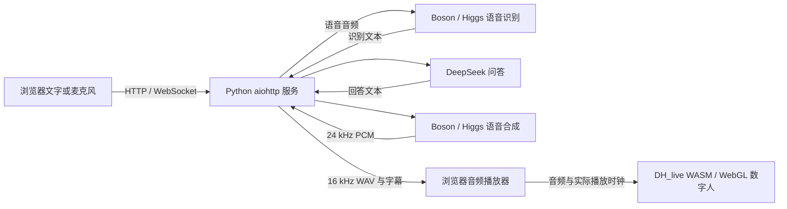

# 架构与运行流程

服务端识别语音后调用语言模型，按句段将回答交给语音合成服务，再把 WAV 与字幕发到浏览器。文字问答跳过语音识别步骤。数字人仅在实时视频模式加载，代码、人物视频和配套参数由本服务提供。

默认使用专家音色。服务启动时检查原 Voice ID 在当前 Boson 账户中是否可用；不可用时，用 `voice/expert/` 中的参考录音和逐字稿注册音色，随后四种模式统一使用取得的 Voice ID。显式配置自己的 Voice ID 或 `default` 时跳过自动注册。

浏览器用实际音频播放时间推进数字人口型。服务端生成结束后，浏览器仍需播放队列中的音频；收到浏览器的 `played` 确认才完成该轮。实时模式最多保留最近六轮已播完的问答。

实时模式持续上传麦克风音频，通过语音服务的 VAD 与本地音频能量确认插话。插话后取消旧回答与合成任务，停止浏览器音频并清空旧口型。语音问答则在回答期间暂停录音上传。

默认识别提供方为 Higgs。`voice_turn.py` 保留可选 DeepSeek 语音问答识别分支，仅在 `VOICE_ASR_PROVIDER=deepseek` 时启用；默认配置无需该分支的服务权限。

同一浏览器同时一通会话；不同浏览器独立持有会话、语音连接和历史。访客 Cookie 使用服务端随机密钥签名。应用不保存对话，服务重启会结束正在进行的通话。

用户语音发送给 Boson/Higgs，问题与实时模式对话历史发送给 DeepSeek，回答文本发送给 Boson/Higgs 合成。Key 只从服务端环境或 `.env` 读取，不下发到网页。诊断接口仅记录白名单状态字段，不记录录音、问题或密钥。
